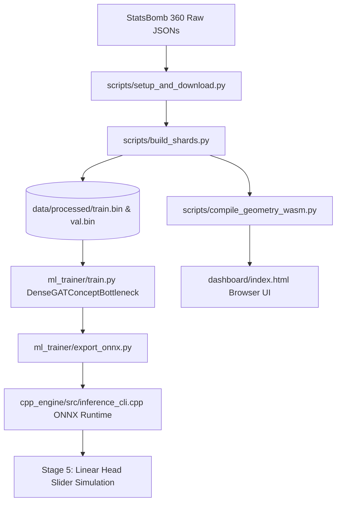

# Architecture Specification: Tactical-CBM Engine

## 1. System Overview

The **Tactical-CBM Engine** is an interpretable Graph Neural Network (GNN) runtime for real-time tactical evaluation and counterfactual simulation in football (soccer). It maps spatial player tracking coordinates into human-understandable geometric tactical concepts ($C_1 \dots C_6$), which then determine goal threat probability ($Y \in [0, 1]$).



---

## 2. Mathematical Pipeline: 6 Concept Bottlenecks

Rather than predicting threat directly through opaque black-box embeddings, all tactical representations are projected through **6 canonical concepts**:

| Concept | Name | Mathematical Definition | Pitch Normalization |
| :--- | :--- | :--- | :--- |
| **$C_1$** | **Defensive Line Height** | $(120.0 - \max(X_{\text{deepest\_def}}, X_{\text{ball}})) / 70.0$ | $[0, 1]$ (70m ceiling from defended goal line) |
| **$C_2$** | **Defensive Compactness** | $1.0 - (\text{ConvexHull}(\mathbf{P}_{\text{def}}) \times s / 1200.0)$ | $[0, 1]$ ($s = \sqrt{10/\max(N_{\text{vis}}, 4)}$ frustum scale) |
| **$C_3$** | **Defensive Width Balance** | $(\text{Spread}_y / 45.0) \times (1.0 - \text{Offset}_y \times 0.5)$ | $[0, 1]$ (Lateral spread adjusted for ball shift) |
| **$C_4$** | **Ball-Carrier Pressure** | $\exp(-d_{\min}/4.0) \times 0.7 + (\min(N_{\le 6\text{m}}, 3)/3.0) \times 0.3$ | $[0, 1]$ (Immediate decay + swarm count) |
| **$C_5$** | **Passing Lane Blockage** | $\frac{1}{\|A_{\text{fwd}}\|} \sum_{a \in A_{\text{fwd}}} \mathbb{I}(\min_{d} \text{dist}(d, \overline{ba}) \le 2.2\text{m})$ | $[0, 1]$ (Central corridor interception ray) |
| **$C_6$** | **Box Overload Ratio** | $\frac{N_{\text{att\_box}}}{N_{\text{att\_box}} + N_{\text{def\_box}}}$ | $[0, 1]$ (Penalty box density: $X \ge 102, Y \in [18, 62]$) |

---

## 3. The 2,588-Byte Binary Shard Contract

All tracking frames are stored in fixed-stride, zero-copy memory-mapped binary shards ([`train.bin`](file:///d:/Tactical%20CBM%20Engine/data/processed/train.bin) and [`val.bin`](file:///d:/Tactical%20CBM%20Engine/data/processed/val.bin)):

```
#pragma pack(push, 1)
struct TacticalFrameRecord {
    int32_t match_id;                    // Offset 0    (4 bytes)
    int32_t frame_id;                    // Offset 4    (4 bytes)
    float   node_features[22][6];        // Offset 8    (528 bytes)
    float   adj_mask[22][22];            // Offset 536  (1,936 bytes)
    float   player_mask[22];             // Offset 2472 (88 bytes)
    float   c_true[6];                   // Offset 2560 (24 bytes)
    float   y_threat;                    // Offset 2584 (4 bytes)
};                                       // Total: 2,588 bytes
#pragma pack(pop)
```

Static assertion guards in [`cpp_engine/include/shard_format.hpp`](file:///d:/Tactical%20CBM%20Engine/cpp_engine/include/shard_format.hpp) and [`scripts/schema.py`](file:///d:/Tactical%20CBM%20Engine/scripts/schema.py) ensure bit-for-bit layout consistency across compilers.

---

## 4. Multi-Runtime Architectural Parity

The engine achieves identical mathematical evaluation across three target execution runtimes:

1. **Python Training Runtime:** [`scripts/geometry.py`](file:///d:/Tactical%20CBM%20Engine/scripts/geometry.py) with NumPy and SciPy.
2. **C++ Native / Embedded Runtime:** [`cpp_engine/include/geometry.hpp`](file:///d:/Tactical%20CBM%20Engine/cpp_engine/include/geometry.hpp) with Andrew's Monotone Chain 2D convex hull.
3. **WebAssembly / Browser Runtime:** [`dashboard/tactical_geometry.wasm`](file:///d:/Tactical%20CBM%20Engine/dashboard/tactical_geometry.wasm) loaded dynamically by [`dashboard/index.html`](file:///d:/Tactical%20CBM%20Engine/dashboard/index.html) for zero-drift client-side 60 FPS tactical canvas interactions.
