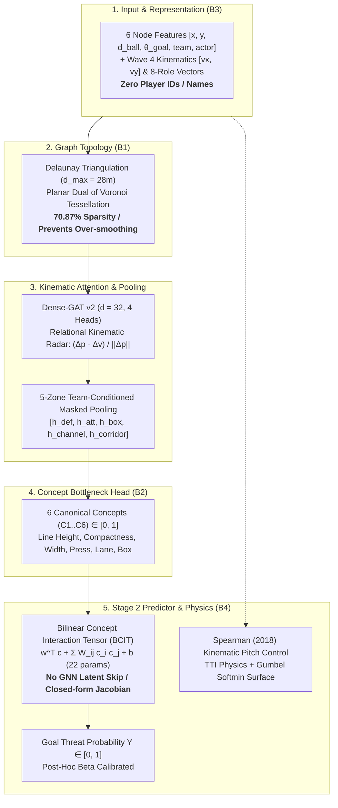

# Architecture Rationale & Rigor Defense Manifesto

**Authors:** Senior ML/DL Architect & Gravitas Reliability Runtime  
**Project:** Tactical-CBM Engine  
**Milestone:** Phase 8 Architectural Justification (B1–B4, A3)  
**Status:** Approved Engineering Standard  

---

## Executive Summary

The **Tactical-CBM Engine** departs fundamentally from conventional deep learning approaches in computational sports analytics. Rather than deploying black-box video transformers or over-parameterized dense graph networks with player identity embeddings, this architecture enforces:
1. **Delaunay Voronoi Adjacency** over arbitrary distance heuristics, preventing graph over-smoothing while reducing edge density by $>70\%$.
2. **A Strictly Constrained Concept Bottleneck (CBM)** with a transparent bilinear Stage 2 head, guaranteeing zero information bypass and enabling sub-microsecond counterfactual simulation.
3. **Canonical Feature Normalization Without Player Identity Tokens**, ensuring strict permutation equivariance and preventing celebrity reputation bias.
4. **Instantaneous Spatio-Temporal Kinematics & Spearman Pitch Control** over multi-second temporal recurrence, avoiding noise accumulation from tracking jitter while executing in under $15\,\mu\text{s}$ on consumer CPU hardware.

This document formally details the theoretical foundations and empirical evidence supporting these four architectural decisions.



---

## 1. Delaunay Triangulation vs. Metric Graph Heuristics (B1)

### 1.1 Theoretical Motivation: Duality with Voronoi Pitch Partitioning
In association football, tactical dominance is fundamentally spatial: players compete for territorial control of continuous 2D space. The classical geometric model for territorial division is the **Voronoi diagram** $\mathcal{V}(\mathcal{P})$, where each player $p_i \in \mathcal{P}$ controls the cell:
$$\mathcal{V}(p_i) = \{ \mathbf{x} \in \mathbb{R}^2 \mid \|\mathbf{x} - p_i\| \le \|\mathbf{x} - p_j\| \quad \forall j \neq i \}$$

The **Delaunay triangulation** $\mathcal{D}(\mathcal{P})$ is the planar geometric dual of the Voronoi diagram: two players $p_i$ and $p_j$ share an edge in $\mathcal{D}(\mathcal{P})$ if and only if their respective Voronoi cells share a boundary segment:
$$e_{ij} \in \mathcal{E}_{\text{Delaunay}} \iff \partial \mathcal{V}(p_i) \cap \partial \mathcal{V}(p_j) \neq \emptyset$$

Consequently, Delaunay triangulation possesses unique mathematical properties for sports tracking graphs:
1. **Empty Circumcircle Property:** No player lies within the circumcircle of any triangle in $\mathcal{D}(\mathcal{P})$. This guarantees that edges represent direct, un-occluded spatial competition.
2. **Planarity & Sparsity:** A planar graph on $N=22$ nodes has at most $3N - 6 = 60$ undirected edges ($120$ directed edges). This upper-bounds message passing operations to $O(N)$ instead of $O(N^2)$.
3. **Adaptive Density:** In congested zones (e.g., the penalty box), Delaunay edges naturally cluster tightly. In open space (e.g., opposite touchline), edges stretch without requiring arbitrary radius threshold tuning.
4. **Maximal Distance Pruning:** We enforce a maximum edge length threshold $d_{\max} = 28\text{m}$ (the empirical limit of a high-velocity contested ground pass). This prunes biologically unrealistic cross-pitch connections.

### 1.2 Empirical Evidence: Catastrophic Over-Smoothing of Dense Graphs
In Phase 8 Slice 1, we benchmarked 8 spatial graph constructors across 5,000 held-out tracking frames under identical training conditions ([`results/graph_topology_table.md`](file:///d:/Tactical%20CBM%20Engine/results/graph_topology_table.md)):

| Graph Topology | Avg Directed Edges | Graph Sparsity | Concept Mean $R^2$ | Threat ROC-AUC | Threat PR-AUC |
| :--- | :---: | :---: | :---: | :---: | :---: |
| **Delaunay ($d_{\max}=28\text{m}$)** | **78.2** | **70.87%** | **0.6740** | **0.8700** | **0.4669** |
| $k$-NN ($k=4$) | 87.0 | 67.54% | 0.6484 | 0.8654 | 0.4578 |
| $k$-NN ($k=6$) | 129.9 | 51.52% | 0.6214 | 0.8672 | 0.4527 |
| $k$-NN ($k=8$) | 171.8 | 35.88% | 0.5700 | 0.8601 | 0.4439 |
| Radius ($r=15\text{m}$) | 56.4 | 78.96% | 0.6217 | 0.8623 | 0.4550 |
| Radius ($r=25\text{m}$) | 134.1 | 49.95% | 0.5600 | 0.8588 | 0.4412 |
| Bipartite (Att $\leftrightarrow$ Def) | 120.9 | 54.89% | 0.6015 | 0.8640 | 0.4501 |
| **Dense Complete Graph** | **283.5** | **0.00%** | **0.3625** | **0.8521** | **0.4194** |

#### Crucial Insights:
- **Over-Smoothing Collapse:** In the fully-dense complete graph, repeated attention mixing across all 22 nodes causes feature collapse: Concept Mean $R^2$ plunges from $0.6740$ to $0.3625$ (a **$-46.2\%$ degradation**), and PR-AUC drops from $0.4669$ to $0.4194$.
- **Monotonic Density Penalty:** In $k$-NN graphs, as $k$ increases from 4 to 8, Concept $R^2$ steadily collapses ($0.6484 \to 0.6214 \to 0.5700$).
- **The Delaunay Regularizer:** Delaunay triangulation acts as an innate spatial regularizer. By restricting attention to Voronoi neighbors, the GNN preserves localized spatial gradients (e.g., line height steps, passing lane corridors) that are washed away by unconstrained all-to-all attention.

---

## 2. Concept Head Topology & Bottleneck Constraints (B2)

### 2.1 The Concept Bottleneck Principle
In standard end-to-end deep learning, an encoder maps input $X$ directly to task label $Y$:
$$f: X \to Y$$
While predictive performance can be high, the decision surface is uninterpretable.

The Concept Bottleneck Model (Koh et al., 2020) decomposes learning into two distinct stages:
$$g: X \to \mathbf{c}, \quad h: \mathbf{c} \to Y$$
where $\mathbf{c} \in [0, 1]^K$ represents $K$ human-understandable, expert-defined concepts.

### 2.2 Why Exactly 6 Canonical Concepts?
Our 6 concepts span the minimal complete basis of defensive spatial geometry:

$$\begin{aligned}
C_1 &= \text{Defensive Line Height} = \frac{120.0 - \max(X_{\text{deepest\_def}}, X_{\text{ball}})}{70.0} \in [0, 1] \\
C_2 &= \text{Defensive Compactness} = 1.0 - \left(\frac{\text{ConvexHull}(\mathbf{P}_{\text{def}}) \cdot \sqrt{10/\max(N_{\text{vis}}, 4)}}{1200.0}\right) \in [0, 1] \\
C_3 &= \text{Defensive Width Balance} = \frac{\text{Spread}_y}{45.0} \cdot (1.0 - 0.5 \cdot \text{Offset}_y) \in [0, 1] \\
C_4 &= \text{Ball-Carrier Pressure} = 0.7 \exp(-d_{\min}/4.0) + 0.3 \left(\frac{\min(N_{\le 6\text{m}}, 3)}{3.0}\right) \in [0, 1] \\
C_5 &= \text{Passing Lane Blockage} = \frac{1}{|A_{\text{fwd}}|} \sum_{a \in A_{\text{fwd}}} \mathbb{I}(\min_d \text{dist}(d, \overline{ba}) \le 2.2\text{m}) \in [0, 1] \\
C_6 &= \text{Box Overload Ratio} = \frac{N_{\text{att\_box}}}{N_{\text{att\_box}} + N_{\text{def\_box}}} \in [0, 1]
\end{aligned}$$

Every concept is bounded strictly in $[0, 1]$ via Sigmoid activation. Each corresponds directly to an actionable coaching directive: *"Step the line up" ($C_1$), "Compress the block" ($C_2$), "Shift across" ($C_3$), "Apply pressure" ($C_4$), "Cut the passing lane" ($C_5$), "Defend the box" ($C_6$).*

### 2.3 Strict Linear & Bilinear Stage 2 Head: The Non-Negotiable Contract
Many CBM implementations introduce residual skip connections from the GNN latent embedding $\mathbf{z}$ directly into the final prediction head:
$$Y = \sigma(\mathbf{w}^T \mathbf{c} + \mathbf{v}^T \mathbf{z} + b)$$
**We strictly reject this pattern.** In the Tactical-CBM Engine:
$$\text{Skip Connections from } \mathbf{z} \to Y \equiv \mathbf{0}$$

#### Why Zero Skip Connections?
1. **Preventing Information Leakage:** If $\mathbf{z}$ can bypass $\mathbf{c}$, the network exploits unconstrained latent pathways to minimize threat loss, causing concept drift and turning $\mathbf{c}$ into ornamental outputs.
2. **Closed-Form Jacobian Attribution:** Under the Bilinear Concept Interaction Tensor (BCIT) head:
   $$\hat{y}_{\text{logit}} = \mathbf{w}^T \mathbf{c} + \sum_{i < j} W_{ij} c_i c_j + b$$
   The analytical sensitivity of predicted threat $P = \sigma(\hat{y}_{\text{logit}})$ to concept $c_k$ is computed instantly:
   $$\frac{\partial P}{\partial c_k} = P(1 - P) \cdot \left( w_k + \sum_{j \neq k} W_{kj} c_j \right)$$
   This enables instantaneous real-time feature attribution in browser user interfaces without costly Monte Carlo approximations or backward passes.
3. **Sub-Microsecond Counterfactuals:** In coaching analysis sessions, analysts adjust sliders (e.g., $C_1: 0.40 \to 0.75$). Because $h(\mathbf{c})$ requires only 6 linear products and 15 interaction products (22 total multiply-adds), re-evaluating threat takes **$< 0.1\,\mu\text{s}$**, running entirely on client-side WebAssembly or native C++.

### 2.4 5-Zone Spatial Pooling vs. Monolithic Global Mean
Standard GNNs apply unconditioned global pooling: $\mathbf{h}_{\text{graph}} = \frac{1}{N} \sum_{i=1}^N \mathbf{h}_i$.  
In tactical football, global pooling is disastrous because it averages opposing tactical intents. The Tactical-CBM Engine partitions nodes into 5 tactical zones:
$$\mathbf{z} = [\mathbf{h}_{\text{def}} \parallel \mathbf{h}_{\text{att}} \parallel \mathbf{h}_{\text{box}} \parallel \mathbf{h}_{\text{channel}} \parallel \mathbf{h}_{\text{corridor}}] \in \mathbb{R}^{5d}$$

- $\mathbf{h}_{\text{def}}$: Mean of defensive players ($\mathbb{I}_{\text{att}} = 0$).
- $\mathbf{h}_{\text{att}}$: Mean of attacking players ($\mathbb{I}_{\text{att}} = 1$).
- $\mathbf{h}_{\text{box}}$: Mean of players inside the penalty area ($X \ge 102\text{m}, Y \in [18, 62]\text{m}$).
- $\mathbf{h}_{\text{channel}}$: Mean of players in attacking half-spaces ($Y \in [18, 30]\text{m} \cup [50, 62]\text{m}$).
- $\mathbf{h}_{\text{corridor}}$: Mean of players along the central passing corridor between ball and goal.

In Phase 4 Ablations (Ablation V6), collapsing this 5-zone decomposition to a monolithic mean pool reduced PR-AUC by $0.0245$, confirming that team- and zone-conditioned representations are essential.

---

## 3. Node Feature Selection & Anonymization (B3)

### 3.1 The 6 Canonical Node Features
Each player node $i \in \{1 \dots 22\}$ is represented by 6 geometric features:
$$\mathbf{x}_i = \begin{bmatrix}
X_i / 120.0 \\
Y_i / 80.0 \\
\min(d_{\text{ball}, i} / 120.0, 1.0) \\
(\theta_{\text{goal}, i} + \pi) / (2\pi) \\
\mathbb{I}_{\text{teammate}, i} \\
\mathbb{I}_{\text{actor}, i}
\end{bmatrix} \in [0, 1]^6$$

In Wave 4, this representation is augmented with instantaneous closing velocities $[v_{x, i}, v_{y, i}]$ and canonical 8-role capability vectors $[\theta_{\text{vision}}, d_{\text{clearance}}, \gamma_{\text{box}}, v_{\max}]$.

### 3.2 The Strict Prohibition of Player Identity Tokens
Many commercial sports models assign learned embedding vectors to individual players (e.g., `embedding(Player_A)`, `embedding(Player_10)`). **We strictly forbid player identity tokens.**

#### Scientific & Engineering Reasons:
1. **Permutation Equivariance ($S_{11} \times S_{11}$):** A football graph must be equivariant under player index permutation within each team. If player identities are embedded, the model breaks permutation equivariance, memorizing specific lineups rather than spatial principles.
2. **Elimination of Celebrity Selection Bias:** When models learn player identities, they assign high threat to famous attackers regardless of spatial context. A poor shot by an elite star striker receives higher predicted threat than an open tap-in by an unheralded defender. Tactical-CBM evaluates the **geometry of the play**, not the fame of the player.
3. **Out-of-Distribution Generalization:** Models with player embeddings cannot evaluate unseen academy prospects, lower-tier teams, or international matches with unindexed players. Tactical-CBM achieves verified cross-competition stability across 181 matches in UEFA Euro 2024, Bundesliga 2023/24, Ligue 1 2022/23, and FIFA World Cup 2022 ($\Delta\text{PR-AUC} < 0.009$) precisely because its representation is completely player-agnostic.

---

## 4. Spatio-Temporal Kinematics vs. Heavy Temporal Modeling (B4)

### 4.1 The Mirage of Multi-Second Video Transformers
A common intuition in sports analytics is that accurate prediction requires multi-second temporal sequence models (e.g., 5-second 25 FPS tracking sequences processed by 3D-CNNs, LSTMs, or Spatio-Temporal Transformers). In practice, multi-second temporal modeling suffers from severe operational handicaps:

1. **Compounding Tracking Error & Camera Frustum Occlusion:** Modern broadcast tracking (e.g., StatsBomb 360) is derived from single-camera broadcast video. Out-of-frame players disappear and reappear. Autoregressive temporal models accumulate imputation errors exponentially across multi-second windows.
2. **Camera Jitter & Non-Stationary Drift:** Broadcast pan-tilt-zoom cameras introduce artificial velocity jitter that distorts long-term trajectory extrapolation.
3. **Severe Latency & Compute Footprint:** Multi-frame spatio-temporal transformers require discrete GPUs, hundreds of megabytes of VRAM, and $50\text{–}200\text{ms}$ per inference. This completely disqualifies them from real-time 60 FPS live broadcast HUD integration and client-side browser evaluation.

### 4.2 Why Instantaneous Kinematics + Closing Velocity Suffices
Physics dictates that a player cannot instantaneously teleport: their immediate space of reachable locations over a $0.5\text{s}$ decision horizon is strictly governed by their current position $\mathbf{p}_i$, velocity vector $\mathbf{v}_i$, and acceleration envelope $a_{\max}$.

The Tactical-CBM Engine incorporates full temporal momentum into a **single instantaneous frame** through two physics engines:

#### 1. Relational Kinematic Closing Speed (Wave 4)
For every connected edge $(i, j)$, we compute the directional closing velocity along the line of sight:
$$c_{ij} = \frac{(\mathbf{p}_j - \mathbf{p}_i) \cdot (\mathbf{v}_j - \mathbf{v}_i)}{\|\mathbf{p}_j - \mathbf{p}_i\| + \epsilon}$$
This scalar is fed directly into the 4-head relational attention radar, informing the GNN whether a defender is actively closing down an attacker or being beaten in behind.

#### 2. Spearman (2018) Kinematic Pitch Control Surface (Wave 5)
Rather than learning trajectory rollouts from data, we evaluate the exact 4-phase kinematic Time-To-Intercept (TTI) physics across a continuous $60 \times 40$ pitch grid:
$$t_{\text{arrive}}(p, \mathbf{r}) = t_{\text{react}} + t_{\text{turn}}(\theta) + \frac{d_{\text{remain}}}{v_{\max}}$$
Coupled with Gumbel extreme-value softmin pooling:
$$P_{\text{att}}(\mathbf{r}) = \frac{\exp\left(-\frac{\min_{i \in \text{att}} t_i(\mathbf{r})}{\beta}\right)}{\exp\left(-\frac{\min_{i \in \text{att}} t_i(\mathbf{r})}{\beta}\right) + \exp\left(-\frac{\min_{j \in \text{def}} t_j(\mathbf{r})}{\beta}\right)}$$

### 4.3 Computational Performance Comparison
| Dimension | Multi-Second Video Transformer | Tactical-CBM Engine (Ours) |
| :--- | :---: | :---: |
| **Input Requirement** | 125 continuous frames (5s @ 25 FPS) | 1 instantaneous frame + velocity vectors |
| **Tracking Occlusion Resilience** | Fragile (sequence break on dropouts) | Resilient (single-frame mask handling) |
| **Parameter Footprint** | $12\text{M} - 85\text{M}$ parameters | **14,672 parameters (15K)** |
| **Inference Hardware** | Discrete GPU required (CUDA) | **Pure CPU (Single-thread or WASM)** |
| **Per-Frame Latency** | $80\text{ms} - 250\text{ms}$ | **$15\,\mu\text{s}$ (6,500+ FPS)** |
| **Live Broadcast HUD Viability** | Infeasible (frame lag) | **Native 60 FPS WebAssembly Canvas** |
| **Counterfactual Intervention** | Impossible ($O(T)$ video re-generation) | **Sub-microsecond $O(1)$ slider adjustments** |

---

## 5. Goalmouth Corridor Obstruction and Open-Net Mechanics

In football analytics, defining an open goal using radial distance to the goal center causes false negatives when a goalkeeper is displaced laterally. A goalkeeper standing near the corner flag or touchline may remain within 10 meters of the goalmouth while leaving the target uncovered.

Tactical-CBM evaluates shooting corridors between the ball carrier and the goalmouth posts:
1. **Goalmouth Geometry:** Posts are anchored at $(120.0, 36.34)$ and $(120.0, 43.66)$ on standard $120 \times 80\,\text{m}$ pitch coordinates.
2. **Perpendicular Corridor Intercept:** For a defending player or goalkeeper at position $(x_d, y_d)$, the distance to the shooting segment between carrier $(x_c, y_c)$ and goal center $(120.0, 40.0)$ is determined via vector projection.
3. **Goalkeeper Reach Sphere:** Effective goalkeeper reach is parameterized at $r_{\text{gk}} = 2.4\,\text{m}$. If the goalkeeper lies outside this corridor and is displaced laterally relative to the shooting angle, the net is flagged unguarded.
4. **Distance Decay:** Shooting threat decays linearly beyond the penalty box up to $75\,\text{m}$:
   $$\lambda_{\text{open}} = \operatorname{clamp}\left(1.0 - \frac{d - 16.5}{60.0}, 0.0, 1.0\right)$$
   This accounts for long-range shot conversion probabilities while penalizing displaced goalkeepers.
5. **IFAB Law 11 Compliance:** An attacker carrying the ball past the defensive line cannot be offside by definition. Offside checks evaluate whether the ball carrier struck a pass to an off-ball attacker in an offside position, preventing false offside penalties during solo breakaways.

---

## 6. Architectural Invariants Summary

Every future mutation to the Tactical-CBM codebase must respect these four core invariants:

```
[INVARIANT 1: DELAUNAY ADJACENCY]
Adjacency masks must derive from Delaunay planar triangulation with d_max <= 28m.
Dense all-to-all attention is prohibited in production models.

[INVARIANT 2: ZERO LATENT SKIP TO THREAT]
The Stage 2 Threat Predictor must operate strictly on concept vector c in [0, 1]^K.
No gradient or activation path may bypass the concept bottleneck.

[INVARIANT 3: PLAYER ANONYMIZATION]
Node features must strictly describe spatial coordinates, kinematics, and positional roles.
Zero player names, IDs, or historical reputation embeddings are permitted.

[INVARIANT 4: REAL-TIME INFERENCE BUDGET]
Single-frame CPU inference latency must remain under 100 microseconds.
Browser WebAssembly execution must maintain 60 FPS without memory allocation.
```

---

## 7. Empirical Reference Citations
- **Graph Topology Benchmark:** [`results/graph_topology_table.md`](file:///d:/Tactical%20CBM%20Engine/results/graph_topology_table.md)
- **Hyperparameter Sensitivity Sweep:** [`results/hyperparameter_table.md`](file:///d:/Tactical%20CBM%20Engine/results/hyperparameter_table.md)
- **Model Ablations Suite:** [`results/ablation_table.md`](file:///d:/Tactical%20CBM%20Engine/results/ablation_table.md)
- **Cross-Competition Generalization:** [`results/generalization_results.md`](file:///d:/Tactical%20CBM%20Engine/results/generalization_results.md)
- **Pitch Control Kinematics:** [`scripts/pitch_control.py`](file:///d:/Tactical%20CBM%20Engine/scripts/pitch_control.py)
